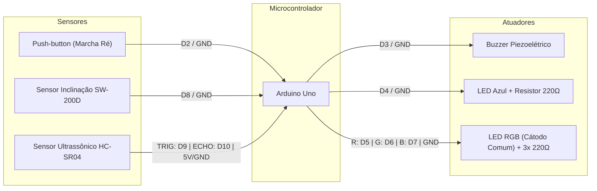

# Sensor de Ré Aprimorado — Sistemas Embarcados

Repositório destinado ao código-fonte e à documentação do trabalho avaliativo **Sensor de Ré Aprimorado** (`SensorDeRe-apimprado.ino`).

---

##  Integrantes da Equipe

- **Rafael Ricetti**
- **Vinicius Sebold**

---

##  Objetivo do Projeto

Desenvolver um sistema embarcado de auxílio à manobra em marcha ré utilizando Arduino, capaz de monitorar a distância de obstáculos traseiros e a inclinação do conjunto, fornecendo **alertas visuais e sonoros progressivos** ao condutor:

- **Ativação por marcha ré:** Um botão (*push-button*) com tratamento de *debounce* alterna o sistema entre **Ponto Neutro (desligado)** e **Marcha Ré Engatada**.
- **Monitoramento de distância (HC-SR04):**
  - **Seguro (`> 50 cm`):** LED RGB em **Verde**, buzzer desligado.
  - **Atenção (`26 cm` a `50 cm`):** LED RGB em **Amarelo**, bipes lentos (`500 ms` / `1200 Hz`).
  - **Perigo (`11 cm` a `25 cm`):** LED RGB em **Vermelho**, bipes rápidos (`150 ms` / `1800 Hz`).
  - **Crítico (`≤ 10 cm`):** LED RGB em **Vermelho**, apito contínuo (`2500 Hz`).
- **Detecção de inclinação (SW-200D):** Um **LED Azul** dedicado acende sempre que o sensor de inclinação é acionado (`LOW`), alertando sobre desníveis ou inclinação do veículo/protótipo.
- **Telemetria Serial:** Exibição contínua da distância medida (em cm) e do estado de inclinação via Monitor Serial (`9600 bps`).

---

##  Lista de Elementos Utilizados

### Microcontrolador
- **1x Arduino Uno R3** (ou placa compatível baseada no ATmega328P)

### Sensores
- **1x Sensor Ultrassônico HC-SR04** (medição de distância de obstáculos)
- **1x Sensor de Inclinação SW-200D** (detecção de inclinação)
- **1x Push-button (chave táctil)** (simulação do engate/desengate da marcha ré)

### Atuadores
- **1x Buzzer Piezoelétrico** (alertas sonoros com variação de frequência e ritmo)
- **1x LED RGB (cátodo comum)** (sinalização visual dos níveis de distância: verde, amarelo e vermelho)
- **1x LED Azul 5 mm** (sinalização visual exclusiva de inclinação)

### Componentes Auxiliares
- **1x Protoboard** (400 ou 830 pontos)
- **4x Resistores de 220 Ω** (limitação de corrente: 1 para o LED Azul e 3 para os canais R, G e B do LED RGB)
- **Jumpers** (macho-macho / macho-fêmea para interligação)
- **1x Cabo USB** (alimentação e gravação/monitoramento serial)

---

##  Custo Estimado do Projeto

Valores aproximados baseados em preços médios de mercado no Brasil (referência de lojas de componentes eletrônicos):

| Item | Quantidade | Valor Unitário Estimado (R$) | Subtotal Estimado (R$) |
| :--- | :---: | :---: | :---: |
| Arduino Uno R3 (compatível) + Cabo USB | 1 | R$ 45,00 | R$ 45,00 |
| Sensor Ultrassônico HC-SR04 | 1 | R$ 12,00 | R$ 12,00 |
| Sensor de Inclinação SW-200D | 1 | R$ 5,00 | R$ 5,00 |
| Push-button (chave táctil) | 1 | R$ 1,00 | R$ 1,00 |
| Buzzer Piezoelétrico | 1 | R$ 4,00 | R$ 4,00 |
| LED RGB (cátodo comum) | 1 | R$ 2,50 | R$ 2,50 |
| LED Azul 5 mm | 1 | R$ 0,50 | R$ 0,50 |
| Resistores 220 Ω | 4 | R$ 0,25 | R$ 1,00 |
| Protoboard (400 pontos) | 1 | R$ 14,00 | R$ 14,00 |
| Kit de Jumpers | 1 | R$ 10,00 | R$ 10,00 |
| **Total Estimado** | — | — | **R$ 95,00** |

> *Observação: Os custos podem variar conforme fornecedor, frete e região.*

---

## Esquema de Montagem e Ligação dos Componentes

As ligações abaixo correspondem exatamente às definições de pinos no código [`SensorDeRe-apimprado.ino`](./SensorDeRe-apimprado.ino).

### Tabela de Pinagem (Pinout)

| Componente | Pino do Componente | Pino no Arduino | Observações |
| :--- | :--- | :---: | :--- |
| **Push-button (Marcha Ré)** | Terminal 1 | `D2` | Configurado com `INPUT_PULLUP` |
| **Push-button (Marcha Ré)** | Terminal 2 | `GND` | Fecha contato para `LOW` ao pressionar |
| **Buzzer Piezoelétrico** | Positivo (`+`) | `D3` | Acionado via `tone()` |
| **Buzzer Piezoelétrico** | Negativo (`-`) | `GND` | — |
| **LED Azul (Inclinação)** | Ânodo (`+`) | `D4` | Ligar em série com resistor de `220 Ω` |
| **LED Azul (Inclinação)** | Cátodo (`-`) | `GND` | — |
| **LED RGB** | Vermelho (`R`) | `D5` | Ligar em série com resistor de `220 Ω` |
| **LED RGB** | Verde (`G`) | `D6` | Ligar em série com resistor de `220 Ω` |
| **LED RGB** | Azul (`B`) | `D7` | Ligar em série com resistor de `220 Ω` |
| **LED RGB** | Cátodo Comum (`-`) | `GND` | — |
| **Sensor de Inclinação SW-200D** | Terminal 1 | `D8` | Configurado com `INPUT_PULLUP` |
| **Sensor de Inclinação SW-200D** | Terminal 2 | `GND` | Em nível `LOW` indica inclinação |
| **Sensor Ultrassônico HC-SR04** | `VCC` | `5V` | Alimentação 5 V |
| **Sensor Ultrassônico HC-SR04** | `TRIG` | `D9` | Saída de disparo do pulso |
| **Sensor Ultrassônico HC-SR04** | `ECHO` | `D10` | Entrada de leitura do eco |
| **Sensor Ultrassônico HC-SR04** | `GND` | `GND` | Terra comum |

### Diagrama Lógico de Conexões

